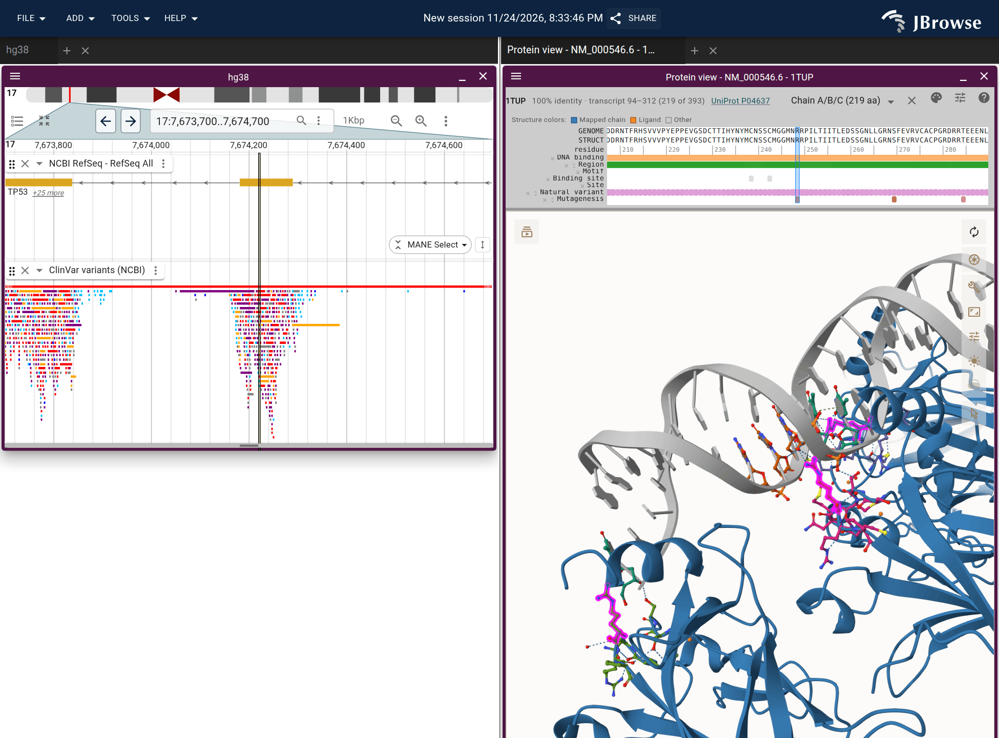
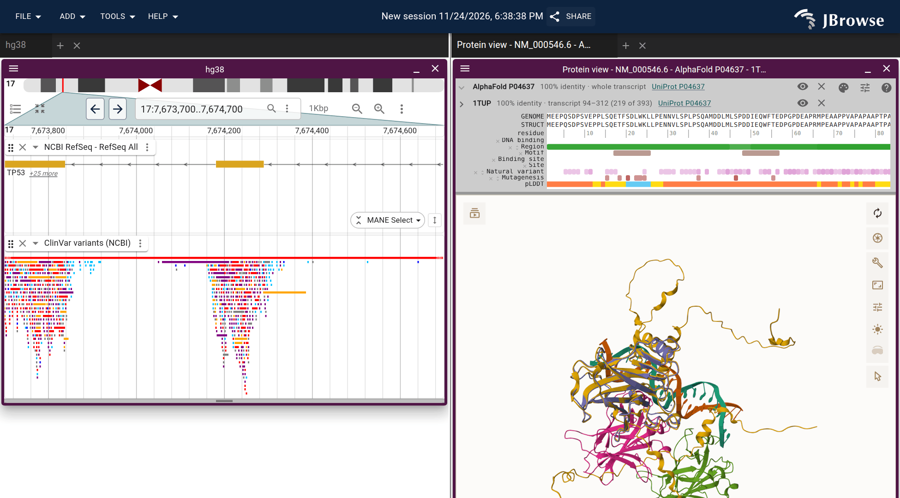
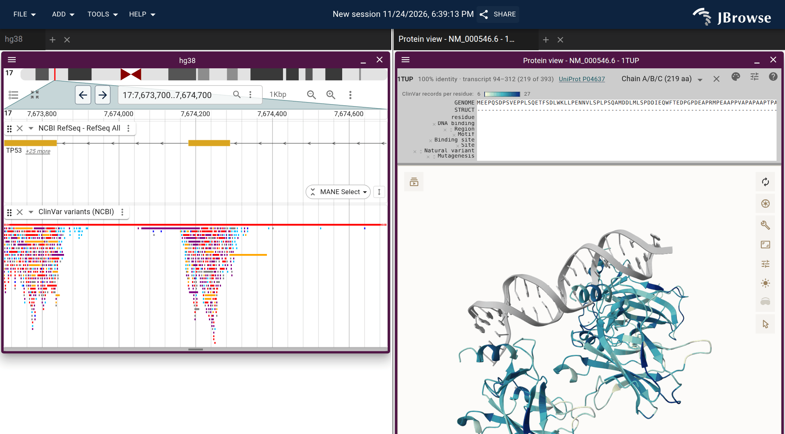
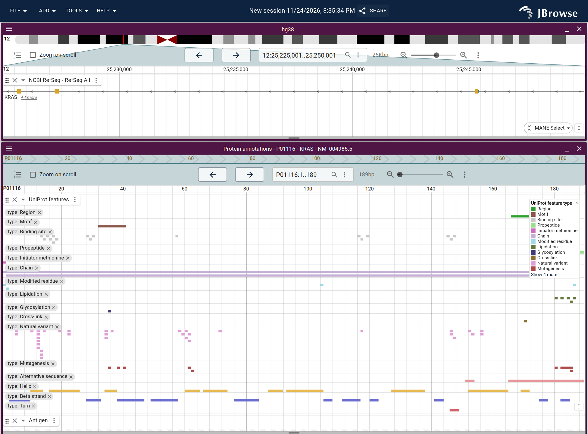

# jbrowse-plugin-protein3d

A 3-D protein structure viewer for JBrowse 2, linked residue by residue to the
genome. The plugin aligns each structure to the transcript's translation, so
hovering a residue highlights its codon and hovering a codon highlights its
residue.

## Gallery

Click a picture to open it live. CI re-renders the figures from `main` every
hour ([scripts/readme-figure.mjs](scripts/readme-figure.mjs)).

<table>
<tr><td width="50%"><a href="https://jbrowse.org/code/jb2/main/?config=%2Fucsc%2Fhg38%2Fconfig.json&amp;session=spec-%7B%22views%22%3A%5B%7B%22type%22%3A%22ProteinView%22%2C%22structures%22%3A%5B%7B%22pdbId%22%3A%221TUP%22%2C%22initialResidues%22%3A%7B%22start%22%3A248%2C%22end%22%3A248%7D%7D%5D%2C%22transcriptId%22%3A%22NM_000546.6%22%2C%22sideBySide%22%3Atrue%2C%22color%22%3A%7B%22field%22%3A%22mappedChain%22%7D%2C%22connectedView%22%3A%7B%22assembly%22%3A%22hg38%22%2C%22loc%22%3A%22chr17%3A7%2C673%2C700-7%2C674%2C700%22%2C%22tracks%22%3A%5B%22hg38-ncbiRefSeqCurated%22%2C%22hg38-clinvarMain%22%5D%7D%7D%5D%7D"></a> R248 on the structure, its codon on the gene</td><td width="50%"><a href="https://jbrowse.org/code/jb2/main/?config=%2Fucsc%2Fhg38%2Fconfig.json&amp;session=spec-%7B%22views%22%3A%5B%7B%22type%22%3A%22ProteinView%22%2C%22structures%22%3A%5B%7B%22uniprotId%22%3A%22P04637%22%7D%2C%7B%22pdbId%22%3A%221TUP%22%7D%5D%2C%22transcriptId%22%3A%22NM_000546.6%22%2C%22sideBySide%22%3Atrue%2C%22connectedView%22%3A%7B%22assembly%22%3A%22hg38%22%2C%22loc%22%3A%22chr17%3A7%2C673%2C700-7%2C674%2C700%22%2C%22tracks%22%3A%5B%22hg38-ncbiRefSeqCurated%22%2C%22hg38-clinvarMain%22%5D%7D%7D%5D%7D"></a> An AlphaFold model and a crystal structure, superposed</td></tr>
<tr><td width="50%"><a href="https://jbrowse.org/code/jb2/main/?config=%2Fucsc%2Fhg38%2Fconfig.json&amp;session=spec-%7B%22views%22%3A%5B%7B%22type%22%3A%22ProteinView%22%2C%22structures%22%3A%5B%7B%22pdbId%22%3A%221TUP%22%7D%5D%2C%22transcriptId%22%3A%22NM_000546.6%22%2C%22sideBySide%22%3Atrue%2C%22color%22%3A%7B%22field%22%3A%22track%22%2C%22trackId%22%3A%22hg38-clinvarMain%22%2C%22stat%22%3A%22count%22%2C%22title%22%3A%22ClinVar%20records%20per%20residue%22%7D%2C%22connectedView%22%3A%7B%22assembly%22%3A%22hg38%22%2C%22loc%22%3A%22chr17%3A7%2C673%2C700-7%2C674%2C700%22%2C%22tracks%22%3A%5B%22hg38-ncbiRefSeqCurated%22%2C%22hg38-clinvarMain%22%5D%7D%7D%5D%7D"></a> Colored by ClinVar records per residue</td><td width="50%"> UniProt features aligned to the gene</td></tr>
</table>

## Use it

- Right-click a gene and choose **Launch › Protein view...**. The dialog looks
  the gene up in UniProt and lists every structure it finds: the AlphaFold
  model, the PDB entries RCSB maps to that entry with their partners and
  ligands, and AlphaFold DB's predicted complexes. Check several to open them
  superposed.
- It can also search Foldseek for related structures, or open your own file.
- Or try the
  [protein browser](https://staging.genomes.jbrowse.org/protein-browser/), which
  opens a gene by name. The plugin is installed by default on
  [genomes.jbrowse.org](https://genomes.jbrowse.org).

## Documentation

- Tutorials on jbrowse.org:
  [TP53 from prediction to crystal](https://jbrowse.org/jb2/docs/tutorials/tp53_structures/)
  and
  [Proteins on genomes.jbrowse.org](https://jbrowse.org/jb2/docs/tutorials/genomes_proteins/)
- [Demos](docs/demos.md): one link per case, from genes opened by name in
  several kingdoms to the structures that are easy to map wrong
- [Your own structures](docs/your-own-structures.md): ColabFold, AlphaFold 3 and
  Boltz models, from a mapping file, a URL or a file
- [Launching](docs/launching.md): session-spec links, every argument, and
  reading what a view resolved (`report`, residue lookup) for scripts and
  agents; [session snapshots](docs/session-snapshots.md) for the saved shape
- [Per-residue values](docs/per-residue-values.md): coloring a structure by a
  genome track or your own numbers
- How it works:
  [genome to structure alignment](docs/genome-to-structure-alignment.md),
  [UniProt feature tracks](docs/uniprot-feature-tracks.md),
  [the secret sauce](docs/secret-sauce.md) and
  [residue numbering](docs/residue-numbering.md)
- [DEVELOPERS.md](DEVELOPERS.md): running, testing and publishing

## Citation

Diesh, C., Stevens, G., Bridge, C., Hogue, G., Buels, R., Cain, S., Stein, L., &
Holmes, I. (2026). Proteins in the Genome Browser: Integration of Phylogenies,
Alignments, and Structures With Nucleotide-level Evidence in JBrowse 2. Journal
of Molecular Biology, 169645. https://doi.org/10.1016/j.jmb.2026.169645. See
also https://github.com/GMOD/proteinbrowser.
